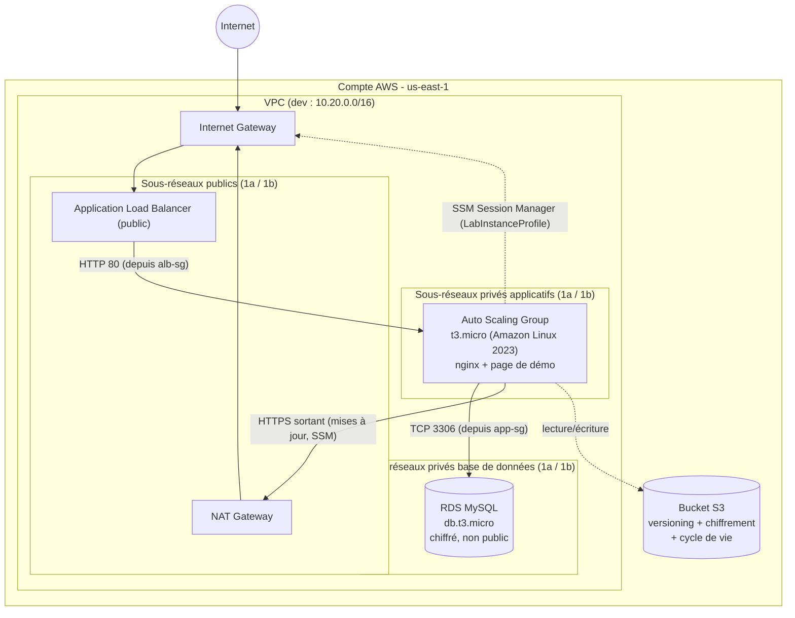
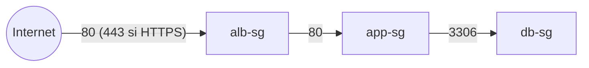
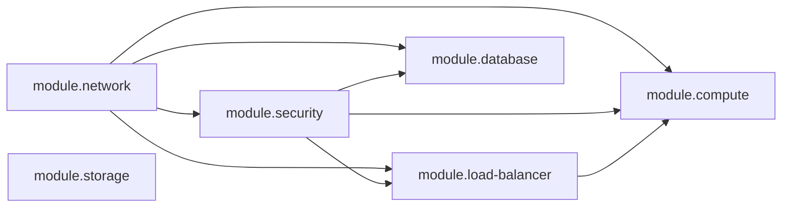

# Architecture — plateforme Web haute disponibilité (`cloud5`)

> Schéma d'architecture, découpage réseau et dépendances entre modules.
> Environnement de référence : **`dev`** (VPC `10.20.0.0/16`). Les autres
> environnements sont identiques à l'exception du CIDR et des réglages de
> dimensionnement (voir §4).

## 1. Vue d'ensemble

- **Aucun accès SSH** : l'administration se fait par **SSM Session Manager**
  (le rôle `LabInstanceProfile` est attaché aux instances).
- La base de données n'a **aucune route vers Internet** (seule la route locale du
  VPC existe dans sa table de routage).
- Le bucket S3 est **privé** (les 4 options de blocage public sont activées).

## 2. Découpage réseau

Deux zones de disponibilité (`us-east-1a`, `us-east-1b`), trois niveaux de
sous-réseaux :

| Niveau | Sous-réseaux | CIDR (dev) | Route par défaut | Rôle |
|--------|--------------|------------|------------------|------|
| Public | `public-a`, `public-b` | `10.20.1.0/24`, `10.20.2.0/24` | Internet Gateway | ALB, NAT Gateway |
| Applicatif (privé) | `app-a`, `app-b` | `10.20.11.0/24`, `10.20.12.0/24` | NAT Gateway | Instances EC2 (ASG) |
| Base de données (privé) | `db-a`, `db-b` | `10.20.21.0/24`, `10.20.22.0/24` | **aucune** | RDS |

Les CIDR sont calculés avec `cidrsubnet(var.vpc_cidr, 8, n)` : changer le CIDR du
VPC suffit à redéployer tout le plan d'adressage.

## 3. Chaîne de Security Groups (moindre privilège)

Chaque niveau n'accepte que le **Security Group du niveau précédent** (référence
de SG, jamais de CIDR). Voir `docs/securite.md` §1.

## 4. Différences entre environnements

| Réglage | dev | test | prod |
|---------|-----|------|------|
| `vpc_cidr` | `10.20.0.0/16` | `10.21.0.0/16` | `10.22.0.0/16` |
| NAT Gateway | 1 partagé | 1 partagé | **1 par AZ** |
| `max_size` (ASG) | 3 | 3 | 4 |
| RDS `multi_az` | non | non | **oui** |
| Sauvegardes RDS | 1 jour | 3 jours | 7 jours |
| Snapshot final / protection suppression | non | non | **oui** |

## 5. Dépendances entre modules Terraform

- `module.network` : VPC, sous-réseaux, IGW, NAT, tables de routage.
- `module.security` : 3 Security Groups chaînés + *data sources* `LabRole` /
  `LabInstanceProfile` (IAM préexistant du lab).
- `module.load-balancer` : ALB, groupe cible, écouteurs HTTP (+ HTTPS optionnel).
- `module.compute` : AMI AL2023, Launch Template, Auto Scaling Group, politique
  de scaling (CPU cible 50 %). `depends_on = [module.network]` garantit que la
  route NAT existe avant le démarrage des instances.
- `module.database` : groupe de sous-réseaux + instance RDS MySQL privée.
- `module.storage` : bucket S3 (créé via `terraform_data` + AWS CLI, voir
  `docs/notes-storage-module.md`).

Le câblage complet se trouve dans `environments/<env>/main.tf`.
